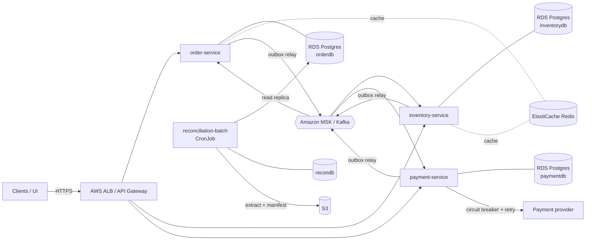
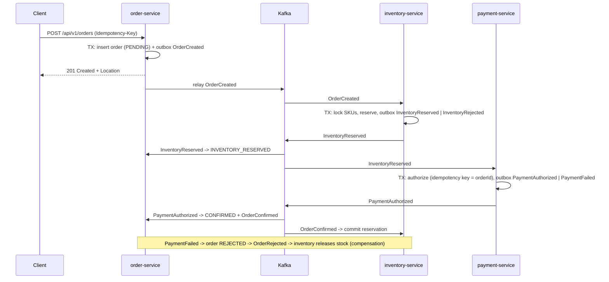
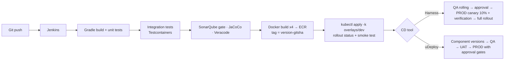

# Order Processing: Architecture

An order processing system built from Spring Boot microservices on AWS. Each section below maps
to a design goal and names the code that implements it, so every claim can be checked in the source.

## 1. Overview

| Module | Responsibility | Owns |
|---|---|---|
| `order-service` | Order API, order lifecycle (saga state owner) | `orderdb`: orders, lines, status history |
| `inventory-service` | Stock levels, reservations, compensation (release) | `inventorydb` |
| `payment-service` | Payment authorization via the external gateway | `paymentdb` |
| `reconciliation-batch` | Daily completeness check + extract to S3 with manifest | `recondb` |
| `platform-common` | Shared library: event contract, outbox, inbox, DLT, correlation IDs, error format | (no data) |

Each service owns its own database. There are no shared tables and no cross-service joins. Services
integrate only through REST (synchronous queries) and Kafka events (state changes).

## 2. Order flow: a choreographed saga

Why choreography rather than an orchestrator: there are three participants and a linear flow, so
events keep the services decoupled without a central coordinator to scale and operate. The order
service still owns the state machine ([`OrderStatus`](../order-service/src/main/java/com/acme/orderplatform/order/domain/OrderStatus.java)),
so the full lifecycle can be read in one place. If the flow grows (shipping, fraud checks,
timeouts), the next step is an orchestrator such as AWS Step Functions or Temporal.

## 3. Scalability

| Technique | Where | Why it scales |
|---|---|---|
| Stateless services + HPA | `deploy/k8s/base/*-service.yaml` | Any pod can serve any request; state lives in Postgres, Redis and Kafka. The HPA adds pods on CPU. |
| Kafka partitioning, keyed by `orderId` | `Topics`, `OutboxRelay` | Consumer parallelism = number of partitions (6 here, more in prod). Keying keeps each order's events in order. |
| Listener concurrency | `app.kafka.listener-concurrency` | Several consumer threads per pod; total consumers stay ≤ partitions. |
| Java 21 virtual threads | `spring.threads.virtual.enabled` | Many concurrent HTTP requests without large platform thread pools. |
| Redis cache-aside | `CacheConfig`, `OrderCache` | Hot reads (`GET /orders/{id}`, stock) skip the database. TTLs plus evict-after-commit. |
| Read replica for batch | `reconciliation-batch` `ordersDataSource` | Reporting load never hits the primary that takes writes. |
| Partitioned batch | `HashPartitioner`, `reconcileOrders` step | Each hash bucket is processed in parallel with its own checkpoint. The grid size is a config value. |
| JDBC batching, connection pools | `hibernate.jdbc.batch_size`, Hikari settings | Fewer round trips; pool sizes are set so `pods × pool ≤ RDS max_connections`. |
| Indexes for every access path | Flyway `V1__*.sql` | Customer history, status scans, a partial index on the unpublished outbox. |

Capacity rule of thumb: `maxReplicas × listener-concurrency ≤ partitions` and
`maxReplicas × DB_POOL_SIZE ≤ max_connections - headroom`. Beyond that, add partitions, or put RDS Proxy in front of the database.

## 4. Resilience and data reliability

| Failure | Handling | Code |
|---|---|---|
| Order committed but event lost (dual write) | **Transactional outbox**: the event is written in the same DB transaction and relayed afterwards | `OutboxWriter`, `OutboxRelay` |
| Event delivered twice (at-least-once) | **Idempotent consumers**: `processed_event` insert in the same transaction as the business change | `ProcessedEventStore` |
| Client retries POST after a timeout | **Idempotency-Key** with a unique constraint plus a request fingerprint (same key with a different body gives 422) | `OrderService.placeOrder` |
| Two pods relay the outbox at once | `SELECT … FOR UPDATE SKIP LOCKED`, so each pod claims a separate batch | `OutboxRelay` |
| Two orders want the same SKU | Pessimistic row locks in **sorted SKU order** (no deadlocks), with a lock timeout | `StockItemRepository.lockAll` |
| Concurrent update of one order | Optimistic locking (`@Version`), returned as 409 | `CustomerOrder`, `GlobalExceptionHandler` |
| Transient error in a consumer | Retry with exponential backoff (500 ms → 10 s, 4 attempts) | `PlatformMessagingAutoConfiguration` |
| Poison message | No retry; goes straight to `<topic>.DLT` with the exception in its headers; metric + alert; replay after a fix | same |
| Payment provider slow or down | Resilience4j **retry + circuit breaker**; the provider idempotency key prevents double charges | `ResilientPaymentClient` |
| Late event after cancel | The state machine refuses the transition; counted, and flagged for refund | `OrderSagaHandler` |
| Redis down | Treated as a cache miss (`LoggingCacheErrorHandler`); correctness never depends on Redis | `CacheConfig` |
| Pod or AZ failure | 3+ replicas spread across zones, PodDisruptionBudget, graceful shutdown + preStop drain | k8s manifests |

## 5. Traceability, metadata and completeness

**Every event carries metadata** ([`EventEnvelope`](../platform-common/src/main/java/com/acme/orderplatform/common/events/EventEnvelope.java)):
`eventId` (dedupe), `correlationId` (the original API request), `causationId` (the event that caused
this one), `schemaVersion`, `source`, `occurredAt`. From any order you can rebuild the full chain:
API call → OrderCreated → InventoryReserved → PaymentAuthorized → OrderConfirmed.

**Correlation ID end to end**: `X-Correlation-Id` header → MDC → outbox column → Kafka header →
consumer MDC (`CorrelationIdRecordInterceptor`) → every log line and every error response. OpenTelemetry
trace IDs are propagated through HTTP and Kafka by Micrometer Tracing as well.

**Audit trail**: `order_status_history` records every transition with its reason and correlation ID.

**Completeness, checked every day** by `reconciliation-batch`:

1. Reads the day's orders from the read replica, partitioned and with checkpoints.
2. Flags `STUCK_IN_PROGRESS` (non-terminal past the SLA) and `EVENT_NOT_PUBLISHED` (outbox backlog).
3. Upserts the results, so re-running a day is idempotent.
4. Publishes `orders.csv`, then `_manifest.json` (written last: its presence marks the extract complete) to S3
   with KMS encryption and an S3-verified SHA-256 checksum. The manifest holds the record count, control total,
   counts by status and issue, checksum, job execution ID, schema version and source system.
5. Writes an `extract_audit` row as proof of delivery.

Downstream consumers check that the count, total and checksum match before loading. Nothing is
partially loaded or silently dropped.

## 6. Observability and production support

| Signal | Implementation |
|---|---|
| Logs | Structured JSON (ECS) with `service.name`, `service.version`, `traceId`, `spanId`, `correlationId`, shipped to Splunk / CloudWatch |
| Metrics | Micrometer → Prometheus: HTTP latency histograms + SLO buckets, JVM, Hikari, Kafka consumer lag, plus business metrics: `orders.placed`, `orders.status.transitions`, `outbox.events.pending`, `kafka.records.dead_lettered`, `saga.compensation.required`, `payments{result}` |
| Traces | OpenTelemetry via the OTLP exporter → collector → Jaeger / X-Ray. Sampling 100% in dev, 10% in prod |
| Health | `/actuator/health/liveness` (restart the pod) vs `/actuator/health/readiness` (DB + Redis, removes the pod from the load balancer) |
| Alerts | `deploy/local/alerts.yml`: 5xx rate, p99 latency, outbox backlog, DLT arrivals, circuit breaker open, refund required |
| API errors | RFC 7807 Problem Details with a stable `code` and the `correlationId`; never stack traces or SQL |

**Support runbook (summary)**

- *Customer says the order is stuck*: look up the order → `order_status_history` → search logs by `correlationId` → open the trace.
- *DLT alert*: read the exception header on the DLT record, fix the data or code, replay the record to the main topic (consumers are idempotent, so replaying is safe).
- *Outbox backlog alert*: check the MSK broker health and the relay failure metric. Orders are still accepted, and events go out once Kafka recovers.
- *Reconciliation issues*: `select * from reconciliation_result where issue <> 'NONE'` for the date.

## 7. Maintainability

- **Shared platform library** (`platform-common`) with Spring Boot auto-configuration. Every service gets the
  outbox, inbox, DLT, correlation IDs and error format by adding one dependency. Cross-cutting
  behaviour is the same everywhere and is fixed in one place.
- **Layered packages per service**: `api` (DTOs, controllers) → `service` → `domain` (entities and rules) →
  `messaging`. API DTOs are separate from JPA entities, so the database can change without breaking clients.
- **Business rules in the domain**: `CustomerOrder.transitionTo`, `StockItem.reserve`. The rules are unit-tested without Spring.
- **Schema as code**: Flyway migrations, with `ddl-auto: validate` (Hibernate checks, never changes). Migrations
  are written expand-then-contract, so rolling deploys work with mixed versions.
- **Versioned contracts**: `/api/v1`, `orders.order-events.v1`, `schemaVersion` in every event, versioned
  Redis key prefixes. OpenAPI docs at `/swagger-ui.html`.
- **Twelve-factor config**: everything comes from environment variables, ConfigMaps and Secrets (External Secrets ← AWS Secrets Manager).

## 8. Testing strategy

| Level | Tooling | Examples |
|---|---|---|
| Unit | JUnit 5, AssertJ, Mockito | `CustomerOrderTest`, `OrderServiceTest` (idempotency races), `InventoryServiceTest` (lock order, all-or-nothing), `PaymentEventHandlerTest`, `ReconciliationProcessorTest` |
| Web slice | `@WebMvcTest` + MockMvc | `OrderControllerTest`: 201/200/400/404, validation errors, page cap |
| Integration | Testcontainers (Postgres, Redis, Kafka) | `OrderFlowIntegrationTest`: REST → outbox → Kafka → saga → CONFIRMED, idempotent retry, audit trail |
| Contract / perf (next) | Spring Cloud Contract or Pact; Gatling / JMeter | consumer-driven contracts for events; load test for the 99th percentile SLO |

`./gradlew test` runs in about 30 s on every commit. `./gradlew integrationTest` is a separate CI stage.
JaCoCo coverage is enforced in CI (`jacocoTestCoverageVerification`) and reported to SonarQube.

## 9. CI/CD

- **Build once, promote the same image**: the tag `1.0.<build>-<gitsha>` moves through every environment; nothing is rebuilt.
- **Kubernetes and OpenShift from one base**: `deploy/k8s/base` plus overlays. OpenShift adds Routes, and the image
  runs under any UID in group 0.
- **Rollback**: Harness rolls back automatically when canary verification fails; uDeploy runs `kubectl rollout undo`.

## 10. AWS deployment

| Concern | AWS service |
|---|---|
| Compute | EKS (or ROSA for OpenShift) across 3 AZs |
| Database | RDS PostgreSQL Multi-AZ per service, plus a read replica for orders |
| Cache | ElastiCache Redis (cluster mode, TLS) |
| Messaging | Amazon MSK (3 brokers, RF=3, `min.insync.replicas=2`) |
| Storage | S3 (versioned, KMS-encrypted) for extracts |
| Edge | ALB (AWS Load Balancer Controller) / API Gateway + WAF |
| Secrets & IAM | Secrets Manager + External Secrets; IRSA for pod-level IAM roles |
| Images | ECR with scan-on-push |
| Observability | CloudWatch / Splunk logs, Amazon Managed Prometheus + Grafana, X-Ray / Jaeger |
| Infrastructure as code | Terraform (not included in this repository) |

## 11. Known gaps / next steps

- Authentication: add Spring Security as an OAuth2 resource server (JWT from Cognito or the corporate IdP), and take `customerId` from the token instead of the request body.
- An automatic refund flow when payment is authorized for an already-cancelled order (today it is detected and alerted).
- Outbox table retention (delete published rows older than N days), or switch to Debezium CDC at high volume.
- A saga timeout: orders stuck in a non-terminal state for too long move to REJECTED automatically (today the batch flags them).
- Consumer-driven contract tests for the event schemas, and load tests in the pipeline.
